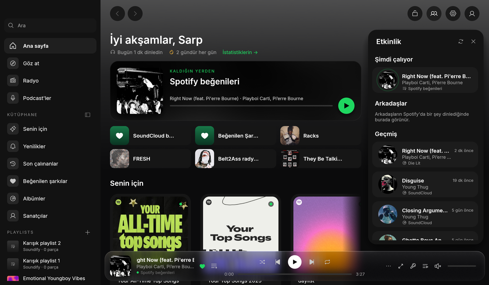
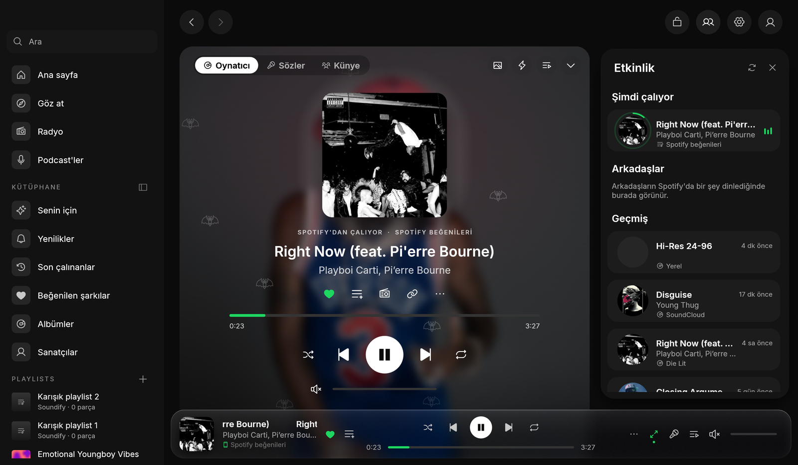
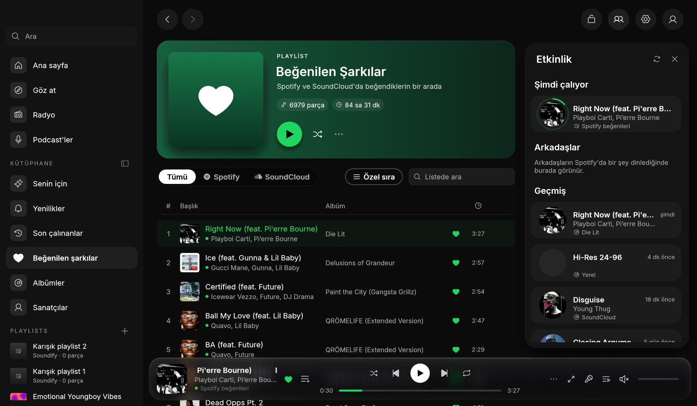
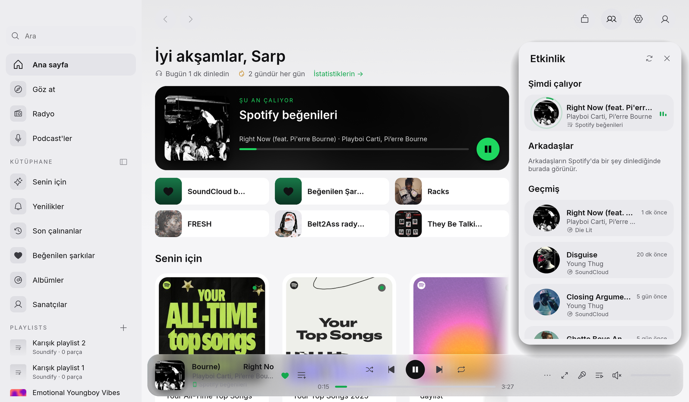

<p align="center">
  
</p>

<p align="center">
  <b>Spotify (Premium) ve SoundCloud'u tek pencerede, tek kuyrukta çalar.</b><br>
  Rust ile yazılmış native uygulama: anında açılır, 200–250 MB bellek kullanır, Electron içermez.
</p>

<p align="center">
  <a href="../../releases/latest"></a>
  
  
</p>

<p align="center">
  
  
</p>

## Kurulum

### macOS (Apple Silicon)

```sh
brew install --cask sar0o/soundify/soundify
```

Homebrew yoksa [son sürümden](../../releases/latest) `Soundify-macos.zip` indir, aç ve
`Soundify.app`'i Uygulamalar'a taşı. Uygulama Apple Developer ID ile imzalı olmadığı için
macOS ilk açılışta durdurur: **Sistem Ayarları → Gizlilik ve Güvenlik**'i aç, en altta
Soundify'ın yanındaki **Yine de aç**'a bas. Homebrew ile kurduğunda bu adım gerekmez.

### Windows 10 / 11

[Son sürümden](../../releases/latest) `Soundify-Kurulum-<sürüm>.exe` indir ve çalıştır.
Yönetici izni istemez, kullanıcı klasörüne kurar. İmzasız olduğu için SmartScreen bir kez
uyarır: **Ek bilgi → Yine de çalıştır**.

## İlk açılış

Açılışta kurulum ekranı hesapları adım adım bağlar. İkisi de zorunlu değil, yalnız biriyle de
kullanabilirsin.

- **Spotify** — Premium gerekir. Tarayıcıda Spotify'ın kendi izin sayfası açılır; şifren
  Soundify'a hiç gelmez, uygulama yalnız dönen anahtarı saklar.
- **SoundCloud** — "Komutu kopyala"ya bas, soundcloud.com'da <kbd>F12</kbd> → Konsol'a yapıştır
  ve Enter'a bas. Soundify panodaki oturumu kendisi tanır. Ücretsiz hesap yeter.

Sonradan **Ayarlar → Hesaplar**'dan değiştirebilir, çıkabilirsin.

## Neler yapar

**İki servis, tek kuyruk.** Spotify ve SoundCloud parçaları aynı listede, aynı kuyrukta çalar;
aralarında geçiş (crossfade) bile var. Beğeniler, playlist'ler, albümler, sanatçılar, radyolar ve
podcast'ler tek kütüphanede toplanır. SoundCloud'daki hayran yüklemelerinde asıl sanatçı
başlıktan çıkarılır.

**Spotify Connect.** Soundify hesabında bir cihaz olarak görünür: telefondaki Spotify onu görür,
çalmayı ona aktarır, uzaktan yönetir. Hoparlör ve TV'ler çıkış menüsünde. Bağlantı koparsa
kendiliğinden kurulur, çalma yerelde sürer.

**Sözler.** Söylenen kelime aydınlanıp hafifçe yükselir, uzaktaki satırlar bulanıklaşır. Coşku
modunda vuruşlarla ışık ve kıvılcım gelir. Kaynaklar: Spotify'ın hece eşitlemesi, LRCLIB, NetEase
ve Genius. SoundCloud başlıklarındaki süslü harfler, yazım farkları ve başa yazılmış sanatçı
adları eşleşmeyi bozmaz; hızlandırılmış sürümlerde zamanlama ölçeklenir. Sözü hiçbir yerde
olmayan SoundCloud parçaları için sözleri sesten yazan isteğe bağlı bir eklenti var
(Ayarlar → Sesten söz).

**İstatistikler.** Hafta, ay, yıl ya da tümü; dinleme süresi, seriler, keşifler, alışkanlıkların
(oturumlar, atlananlar, gece payı), gün × saat haftalık ritim. Sanatçıya göre süzebilir, her
dinlemeyi tek tek listeleyebilirsin. Spotify'dan indirdiğin eski geçmişi de içe aktarır.

**Yerel dosyalar.** Müzik klasörünü ekle: FLAC, ALAC, WAV ve AIFF dokunulmadan çalar, oynatıcıda
"KAYIPSIZ · FLAC · 24 bit · 96 kHz" yazar. Etiketler ve gömülü kapaklar okunur.

**Görünüm.** Oynatıcı çubuğunda gerçek GPU bulanıklığıyla mat cam (ya da klasik düz görünüm).
Büyük oynatıcıda zemin seçilir: bulanık kapak, sanatçı fotoğraflarından slayt, akışkan mermer,
kutup ışıkları, dalgalar, yıldızlar. Koyu ve açık tema, Türkçe ve İngilizce, arayüz ölçeği.

**Ayarlar.** Ekolayzer, uyku zamanlayıcısı, bellek profilleri (Hafif · Dengeli · Tam), "önerme" ve
"çalınmasın" listeleri, playlist'i CSV'ye aktarma, mini oynatıcı.

<p align="center">
  
  
</p>

## Kullanırken işine yarayacaklar

- **Arama** <kbd>⌘K</kbd> ile açılır; açık listenin içinde aramak için <kbd>⌘F</kbd>.
- **Kuyruk** <kbd>⌥⌘Q</kbd>, büyük oynatıcı <kbd>⌥⌘N</kbd>, sözler <kbd>⌥⌘L</kbd>.
- **Benzer parçalar** <kbd>⌥⌘R</kbd>: çalandan yola çıkıp radyo kurar.
- Parçaya sağ tıkla: sıradaki olarak çal, kuyruğa ekle, sanatçıya/albüme git, benzerlerini çal,
  "Bunu önerme" (radyo ve karışımlarda çıkmasın) ya da o sanatçı bir daha hiç çalınmasın.
- Sözler kaymışsa söz satırına dokunup eşitleyebilirsin.
- Bütün kısayollar **Ayarlar → Kısayollar**'da. Windows'ta <kbd>⌘</kbd> yerine <kbd>Ctrl</kbd>.

### Spotify geçmişini içe aktarma

İstatistikler sayfasının altındaki karta Spotify'ın verdiği zip'i bırakman yeter. Bir uyarı:
Spotify'ın **"Hesap verileri"** paketi yalnız son 12 ayı içerir. Baştan beri olan her şey için
[Gizlilik ayarlarından](https://www.spotify.com/account/privacy/) **"Genişletilmiş dinleme
geçmişi"**ni iste; hazırlanması birkaç haftayı bulabilir. Aynı kayıtlar iki kez yazılmaz, yeni
indirmeyi üstüne ekleyebilirsin.

## Güncellemeler

Yeni sürüm çıkınca üst çubukta **Güncelle** belirir: dosya indirilir, SHA-256 ile doğrulanır,
kurulur ve uygulama yeniden açılır. Gelenleri her güncellemeden sonra "Yenilikler" penceresinde
görürsün.

Homebrew ile kurduysan uygulamanın kendi güncellemesi çalışmaya devam eder; dilersen
`brew upgrade --cask --greedy soundify` da diyebilirsin.

## Sınırlar

- **Spotify'da kayıpsız yok.** Spotify FLAC'ı yalnız kendi uygulamalarına, kopya korumalı
  veriyor. Buradaki en yüksek kalite 320 kbps. Kayıpsız dinleme yerel dosyalarla.
- **Canvas (döngü videoları) yok.** Spotify bu istemciye vermiyor.
- **Kişisel kullanım içindir.** İki servis de resmi olmayan istemcileri kabul etmiyor. Ses
  indirilip saklanmaz.
- macOS'ta yalnız Apple Silicon.

## Takıldığında

Günlük dosyası sorunun ne olduğunu çoğu zaman yazar:

- macOS: `~/Library/Application Support/soundify/soundify.log`
- Windows: `%APPDATA%\soundify\soundify.log`

Sorunları [Issues](../../issues)'a yazabilirsin; günlüğün son satırlarını eklersen daha çabuk
bulunur.
